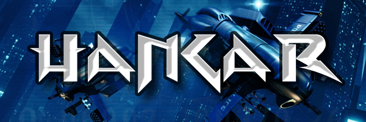
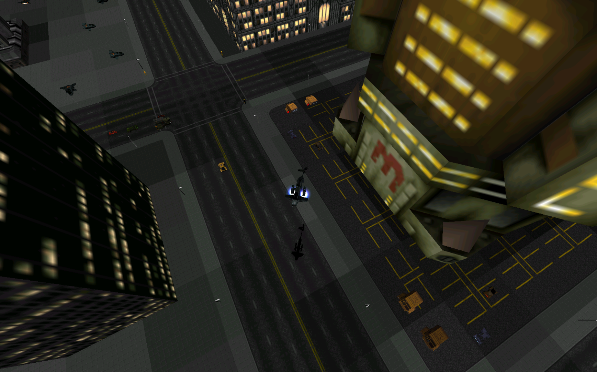
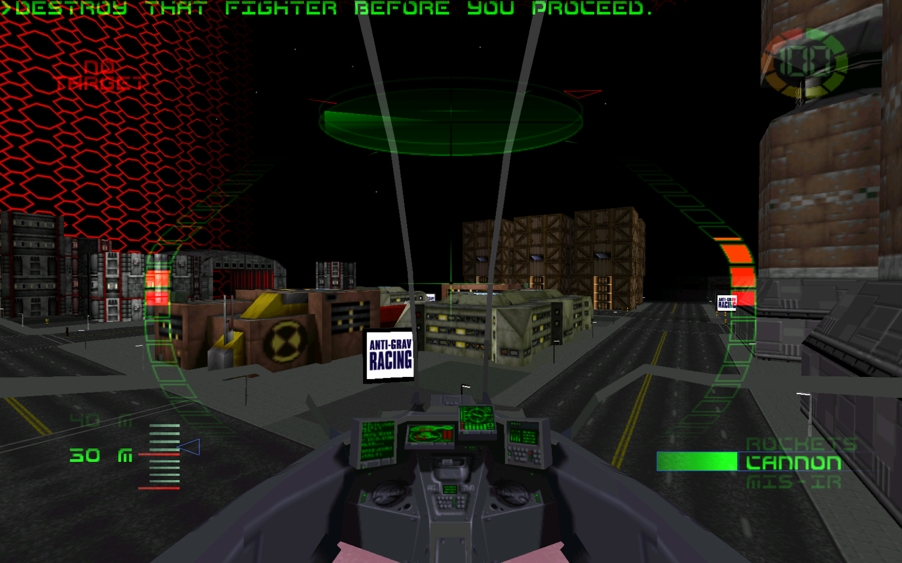
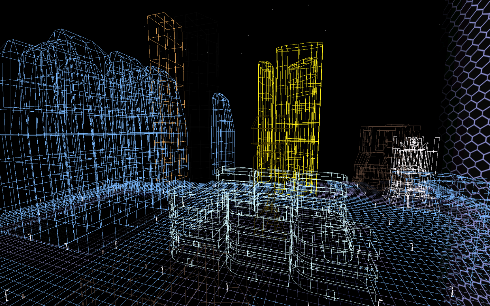
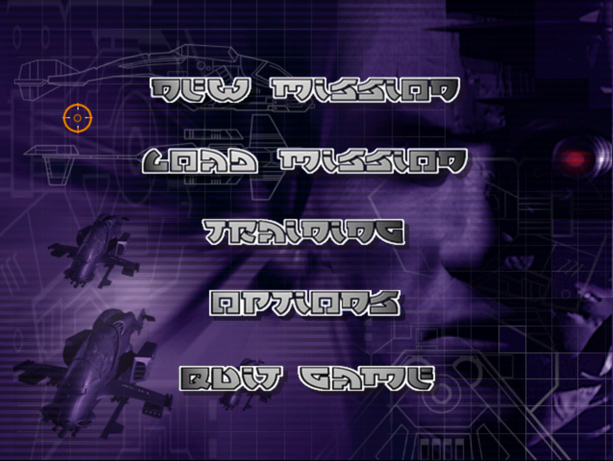
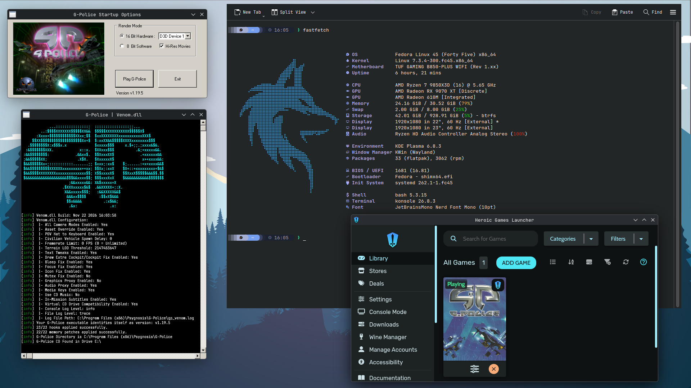

  <div align="center">
    
  </div>

---

# Hangar
Hangar is the collective name for Havoc.exe and Venom.dll.

Havoc.exe is a simple DLL injector.

Venom.dll is a mod/modding base for the PC game G-Police (Psygnosis 1997).

Hangar contains no G-Police assets, code or other data.

Hangar does not modify/overwrite any original G-Police assets, code or other data on-disk. It works by injecting a DLL into the G-Police process at runtime, which modifies bytes in-memory.

Hangar may in the future (either in whole or in part) be used as a basis for more elaborate mods.

## Contents

* [Hangar](#hangar)
* [Features](#features)
* [Basic Usage](#basic-usage)
* [Venom.dll Configuration](#venomdll-configuration)
* [Compatibility](#compatibility)
* [Known Issues](#known-issues)
* [Building from Source](#building-from-source)
* [The AI Ramble](#the-ai-ramble)
* [License](#license)
* [Screenshots](#screenshots)

---

## Features
* No-HUD toggle.
* Pseudo-Wireframe toggle.
* Debug info toggle (equivalent to using the STATTOE cheat, but toggleable so much more convenient).
* Fix for mission briefing text not working under some circumstances/at low volumes.
* Fix for input loss after focus loss (eg. after Alt-Tab, Minimizing).
* Fix for the G-Police window sometimes using an invalid icon.
* Fix for multiple instances being allowed.
* Fix for some elements of the cockpit not being drawn at higher resolutions/high FOVs.
* Tweaks to some text to improve readability.
* Enables customization of the civilian vehicle spawn delay at mission start.
* Enables customization of the fog draw distance (note that this is NOT the same as the maximum render distance! That remains fixed until I figure it out...).
* Enables customization of the FOV multiplier.
* Enables customization of the terrain Level Of Detail threshold.
* Enables setting a framerate limit.
* Enables/Restores all camera modes (ISO CAM and CLOSE CAM were available in some demo versions of G-Police, but were hidden in the retail version).
* Enables overriding of game assets (eg. textures, colour palettes, SFX, music etc).
* Enables the ability to look around the cockpit using keyboard controls (previously exclusive to the Joystick Hat control).
* Enables the display of in-game mission instructions/voiceovers to the top left of the screen.

* DirectDraw/Direct3D hooks.
  * May in the future form a basis for bigger hacks etc. eg. Translation to modern rendering. Right now it's just some quick fixes and QoL to get you in-game without too much headache. Consider disabling this and using DxWnd, dgVoodoo2, DxWrapper or similar wrappers if you want something more mature/fully featured.
  * Fixes startup crash caused by EnumDisplayModes returning too many values and overflowing.
  * Fixes some opaque surfaces appearing transparent. Hacky fix at present, results in gray fringing around transparent textures. Ugly, but less ugly than broken transparency.
  * Allows screen resolutions wider/taller than 2048 pixels. Untested!

* WIMM hooks
Hooks the Windows Multimedia Subsystem (WINMM), passes control to a DirectSound8 player (which may in the future be updated to something more modern). This will fix some audio issues (eg. Main Menu music not looping). It is not however a 1:1 faithful re-implementation of the original game audio system.
  * Enables a few fix for users running G-Police from a Virtual CD Drive, as well as users experiencing issues with G-Police not finding the CD in a physical drive other than D:/
  * Enables the user to use their own music in-game, and control it via medal keys.

---

## Basic Usage
Run Havoc.exe with the command line:

>_"Path to Venom.dll" "Path to GPOLICE.exe"_

eg.

>Havoc.exe _"C:\Hangar\Venom.dll" "C:\Program Files (x86)\Psygnosis\G-Police\GPOLICE.exe"_

Alternatively, you can use your own .dll injector to inject Venom.dll into the G-Police executable.

### Key Bindings
These are currently fixed, I may add the ability to customize them via Venom.cfg at a later time.
| Key | Function | 
| :---: | :----: |
|F2|Display Debug Info (equivalent to STATTOE cheat)|
|F3|Toggle No-HUD|
|F4|Toggle Pseudo Wireframe|
|NUMPAD 1|Look down + left|
|NUMPAD 2|Look down|
|NUMPAD 3|Look down + right|
|NUMPAD 4|Look right|
|NUMPAD 5|Look forward|
|NUMPAD 6|Look left|
|NUMPAD 7|Look left + up|
|NUMPAD 8|Look up|
|NUMPAD 9|Look up + right|
|END|Unloads Venom.dll|

---

## Venom.dll Configuration
All options are configured via Venom.cfg, which must be placed in the same directory as Venom.dll

If no configuration file (Venom.cfg) is present, defaults will be used.

### General Rules
* **Ordering:** Entry ordering does not matter.
* **Defaults:** Missing or invalid entries automatically fall back to their default values.
* **Comments:** Lines starting with `#` or `;` are ignored.
* **Headings:** `[Section]` headers can be used for organization but are ignored by the parser.

---

| Option | Values | Default | Description |
| :--- | :---: | :---: | :--- |
| `Fix_Bleeps` | `true` `false` | `true` | Fixes missing mission briefing text sound effects at low volumes or under certain hardware setups. |
| `Fix_Focus` | `true` `false` | `true` | Fixes unresponsive mouse/keyboard/joystick inputs after Alt-Tabbing or minimizing. Also resolves windowing glitches under Linux (WINE/Proton). |
| `Fix_Icon` | `true` `false` | `true` | Restores the correct application window icon (no effect on Linux). |
| `Fix_Mutex` | `true` `false` | `false` | Properly enforces single-instance restrictions to prevent multiple copies of the game from running simultaneously. |
| `Text_Tweaks` | `true` `false` | `true` | Applies minor adjustments to improve in-game text readability. |
| `Civilian_Vehicle_Spawn_Delay` | Positive Integer | `4500` | Sets the delay before civilian traffic spawns at the start of a mission (`0` spawns them immediately). |
| `Enable_All_Camera_Modes` | `true` `false` | `true` | Unlocks hidden demo camera angles (e.g., `ISO CAM`, `CLOSE CAM`). |
| `Enable_Asset_Override` | `true` `false` | `false` | Allows replacing `.RDT` archive assets via `/override/[ARCHIVE]/[OFFSET]` |
| `Enable_POVHat_To_Keyboard` | `true` `false` | `true` | Maps cockpit look-around controls (normally restricted to joystick POV hats) to the Numpad in Keyboard mode. |
| `Subtitles` | `true` `false` | `false` | Displays in-game mission voiceovers/instructions in the top-left corner (does not apply to FMV cutscenes). |
| `Draw_Extra_Cockpit` | `true` `false` | `true` | Prevents parts of the cockpit interior from clipping out of view at high FOVs or widescreen resolutions. |
| `Fog_Near` | Positive Integer | `175000` | Sets the starting distance for fog effects (does not alter maximum geometry render distance). |
| `Fog_Far` | Positive Integer | `195000` | Sets the ending distance for fog effects (does not alter maximum geometry render distance). |
| `FOV_Multiplier` | Positive Integer | `230` | Adjusts Field of View using the formula: `FOV = [VALUE] * [Screen Width] / 320`. |
| `Terrain_LOD_Threshold` | Positive Integer | `25000` | Distance at which terrain switches to low-resolution textures. |
| `Framerate_Limit` | `0` or Positive Integer | `0` | Caps the in-game framerate (`0` = unlimited, though the engine still caps at your monitor's refresh rate). |
| `Enable_Graphics_Proxy` | `true` `false` | `false` | Hooks DirectDraw/Direct3D to fix startup `EnumDisplayModes` crashes, patch broken transparency (adds minor gray fringing), and unlock resolutions >2048px. *Consider dgVoodoo2 or DxWnd for more mature wrapper features.* |
| `Enable_Audio_Proxy` | `true` `false` | `false` | Routes WINMM audio through DirectSound8 to fix bugs like non-looping menu music. |
| `Virtual_CD_Drive` | `true` `false` | `false` | Improves compatibility with virtual drives and physical CD drives not assigned to `D:\`. Forces `Enable_Audio_Proxy=true`. |
| `Use_CD_Music` | `true` `false` | `true` | When `false`, loads standard PCM `.WAV` files from `/music` instead of a CD. Forces `Enable_Audio_Proxy=true`. |
| `Enable_Media_Keys` | `true` `false` | `false` | Enables hardware media keys (Play/Pause/Stop/Next/Prev) for music playback. Requires `Enable_Audio_Proxy=true`. |
| `Show_Console` | `true` `false` | `true` | Keeps the debug console window open alongside the game. |
| `Console_Log_Level` | `off` `critical` `error` `warn` `info` `debug` `trace` | `info` | Verbosity level for logs printed to the console window. |
| `File_Log_Level` | `off` `critical` `error` `warn` `info` `debug` `trace` | `trace` | Verbosity level for logs written to disk (requires `Log_File_Path` to be set). |
| `Log_File_Path` | Valid file path | *(Empty)* | Destination path for the `.log` file (e.g., _`C:\Psygnosis\G-Police\venom.log`_). Leave empty to disable file logging. |

### Asset Overrides
When `Enable_Asset_Override=true` is set in Venom.cfg, G-Police will use files in the local folder _/override_ will to replace game assets from *.RDT archives.

* eg. _/override/RES.RDT/2EE5038.IMG_ replaces the IMG asset at 0x2EE5038 in the RES.RDT archive.
  * Files prefixed by 0x (eg. 0x2EE5038.IMG) or with a decimal offset (eg. 49172536.IMG) also work.
  * File extensions are not needed (they just help you identify the file types).

* There are some limitations, it's not magic.
Replacing a 5kb texture with a 50mb texture won't give high res textures, it will just crash.

### Music Overrides
When `Use_CD_Music=false` is set in Venom.cfg, G-Police will read music from the local folder _/music_ instead of the CD.

* Use PCM Audio (*.WAV) files.
  * Keep them simple (no non-standard formats!) for best compatibility.
* Files names **CREDITS.WAV**, **DEATH.WAV**, **FAIL.WAV**, **MENU.WAV**, and **SUCCESS.WAV** are special cases, they will be used for credits roll, player death, mission failure, main menu and mission success music respectively.
* Files prefixed with **FLIGHT_** or **COMBAT_** will be queued dynamically, depending on whether you
are in combat or not. If files with these prefixes do not exist, music will be randomized.

---

## Compatibility
### Operating Systems
* **Windows**: Hangar is assumed to be running on modern Windows - Windows 11 primarily, as this is the most recent version of Windows, and Windows 10, as it is still within its consumer Extended Security Updates (ESU) period (ends 12 October, 2027).

* **Linux**: Hangar will run on Linux, via translation layers (WINE/Proton) and/or with launchers such as Lutris and Heroic Launcher. I personally use Fedora 45 KDE as my primary OS, and Hangar works flawlessly on that. I am reasonably confident that Hangar will run on most modern Linux distributions, though as with all things Linux, your mileage may vary.

### G-Police Versions
Multiple different variations of GPOLICE.EXE share the same version number, across various different regions. As such, it is hard to definitively give a list of versions which will definitely work.

This said, Venom.dll uses pattern-scanning and hooking in order to find its targets for modification in-memory, so should be able to adapt well to most variants of GPOLICE.EXE - so far in testing, I have not found a variation which does not work. If you have a version which is not compatible, I would be very interested in knowing about it.

No demo versions of G-Police are fully compatible, and I do not test/design for them. Some features may work, but this is by happy accident, not design.


### Combining with other compatibility shims, translation layers, etc
Many of these work by similar methods to some of Hangar's features; they intercept function calls, manipulate them, translate them etc. To avoid conflicts, I would disable Hangar's Graphics/Audio/Input/etc hooking features as necessary if you are using another tool which also hooks the same systems.

Hangar's features which rely only on memory manipulation should in principle be completely compatible, though I offer no guarantees in that regard.

---

## Known Issues

* **Antivirus Software Identifies Havoc.exe/Venom.dll as Malware**
  * Add Havoc.exe and Venom.dll to your antivirus software's exceptions list.
    * Havoc.exe/Venom.dll both do things which can cause some antivirus software's heuristics to identify it as malicious. eg. Havoc spawns a process then injects a .dll into it, Venom.dll intercepts and redirects calls to the Windows API, DirectX etc. I distribute Havoc.exe/Venom.dll pre-compiled for user convenience. What you gain in convenience, you give in trust. If you do not trust the compiled files, then I strongly encourage you to download and review the source code, then, once you are satisfied that no unwanted behaviour is occurring, you can build them from the source code yourself.

  
* **Error Message: _"The code execution could not proceed because [FILE] was not found. Reinstalling the program may fix this problem."_, Where [FILE] can vary, but is usually MSVCP140.dll, VCRUNTIME140.dll or ucrtbase.dll:**

  * You may have a missing, outdated or corrupted Microsoft Visual C++ Redistributable package/Universal C Runtime (UCRT).
    * Download and install/reinstall the required redistributables from [Microsoft](https://learn.microsoft.com/en-us/cpp/windows/latest-supported-vc-redist?view=msvc-140), then reboot.
    * Download and install/reinstall [KB2999226](https://support.microsoft.com/en-us/servicing/os/windows/2020/04/update-for-universal-c-runtime-in-windows).

* **Havoc/Venom Fails to start (no error message):**

  * If G-Police, Havoc.exe, Venom.dll or Venom.cfg is in a protected directory (eg. _C:\Program Files (x86)\\_), or you have told Venom.dll to write its log file into a protected directory, the problem is probably Windows User Access Control (UAC). Either move the files to a non-protected directory or Run as Administrator.

---

## Building from Source

The solution builds two projects:

* `Havoc` - a 32-bit console application used to inject the DLL
* `Venom` - a 32-bit DLL that provides the G-Police modifications and hooks

Typical Release outputs are:

* `Havoc\Release\Havoc.exe`
* `Venom\Release\Venom.dll`

### Recommended Environment

Hangar was developed on and primarily for Windows, using Visual Studio. If you are inexperienced in programming, I advise using a similar setup if you intend to build it yourself from source.

* Windows 10 or Windows 11 Operating System
* Microsoft Visual Studio 2026 (solution format Visual Studio 18) with:
  * Desktop development with C++ workload
  * MSVC v145 C++ build tools
  * Windows 10 SDK
  * x86/Win32 C++ build support
  * C++ 20 support

The required [spdlog](https://github.com/gabime/spdlog) headers are already included in `include\spdlog` (distributed under the [MIT License](https://choosealicense.com/licenses/mit/)). The DirectX, DirectInput, DirectSound, WinMM, Windows, and Psapi headers/libraries used by the projects are supplied by the Windows SDK and MSVC toolchain.

### Visual Studio

1. Clone or download the source and open `Hangar.sln` in Visual Studio.
2. Select `Release` in the configuration selector.
3. Select `Win32` (shown as `x86` in some Visual Studio views) as the platform.
4. Open **Build > Build Solution**, or press `Ctrl+Shift+B`.


### Command line (MSBuild)

Open **Developer Command Prompt for VS 2026** or **Developer PowerShell for VS 2026**, change directory to the repository root, and run:

```bat
msbuild Hangar.sln /m /t:Build /p:Configuration=Release /p:Platform=Win32
```

### Notes
* Hangar currently targets 32-bit Windows processes. Venom will intentionally fail to compile for x64 or ARM because it currently makes use of inline assembly, which is not supported for those architectures. Build and run the solution using Win32/x86, not x64.

---

## The AI Ramble
**TL;DR:** No AI was used in this project.

I release this at an interesting time for reverse engineering and modding.

[AI decomp/recomp tools](https://github.com/teonett/Reverse-Engineer-Anything) are currently making waves in modding/reversing communities. Whether this is for better or worse remains to be seen. In the meantime, every new project that appears is being judged on whether AI had any part in it's creation, for fear of it being low-quality vibe-coded slop.

Rest assured, all code I have written for this project is lovely, wholesome, human-coded slop.

My rationale for this is less to do with AI itself, and more to do with my goals. This project was never really about the end result, but about the process of learning and tinkering with a game I care about, for the fun of it. I have had to learn a lot about C++, Assembly, the Windows API, audio formats, and vintage versions of DirectX. I hand-coded hooking functions instead of using a library like [MinHook](https://github.com/TsudaKageyu/minhook), because learning how these things work seemed interesting to me, not because it's the easiest or most efficient, or most correct way to do it. I did use [spdlog](https://github.com/gabime/spdlog) for logging though, one of the most important lessons I learned was that you shouldn't roll your own logging library.

All of the reverse-engineering required to make this work was done by myself using tools such as [x32Dbg](https://x64dbg.com/) and [Ghidra](http://ghidra.net/), rather than asking an LLM to decompile the game or find sequences of bytes on my behalf. The process of solving the giant puzzle that is digging through the game's internals is far more meaningful to me than watching an LLM do it for me.

If future contributors to this project want use AI to assist them, I am not in principle opposed to it. All I ask is that anyone doing so uses it as a tool, not as a replacement for their brain. Read and understand the code you are submitting, and participate meaningfully in the art of creation.

---

## License
Hangar is free software.

You may redistribute it and/or modify it under the terms of the [GNU General Public License, Version 3](https://www.gnu.org/licenses/gpl-3.0.en.html) as published by the Free Software Foundation, or (at your option) any later version.

Hangar is distributed in the hope that it will be useful, but WITHOUT ANY WARRANTY; without even the implied warranty of MERCHANTABILITY or FITNESS FOR A PARTICULAR PURPOSE.

---

## Screenshots

Images: Hangar running on Fedora 45 KDE, Re-Enabled hidden ISO CAM view with No-HUD enabled, Asset Override (menu background image overridden with recoloured image), In-Game Subtitles (top left), Pseudo-Wireframe Enabled.

<a href="./images/ISO_CAM.png">
  
</a>
<a href="./images/Subtitles.png">
  
</a>
<a href="./images/Wireframe.png">
  
</a>
<a href="./images/PurpleMenu.png">
  
</a>
<a href="./images/Fedora45.png">
  
</a>

---
